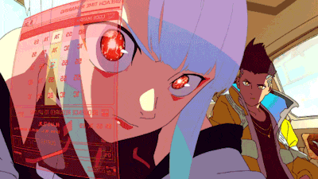

  

#

Me chamo Iuri, busco me desenvolver na programação sempre explorando novas ideias e ferramentas. Sou curioso por jogos e projetos criativos com aprendizado contínuo.
 
#

<h3 align="left">Contato</h3>

<h3 align="left">My Stack ~</h3>

 
 

### GitHub Stats

    
    
    

<picture align="center">
  <source media="(prefers-color-scheme: dark)" srcset="https://raw.githubusercontent.com/iuri-Castro/iuri-Castro/output/github-contribution-grid-snake-dark.svg">
  <source media="(prefers-color-scheme: light)" srcset="https://raw.githubusercontent.com/iuri-Castro/iuri-Castro/output/github-contribution-grid-snake-dark.svg">
  
</picture>

